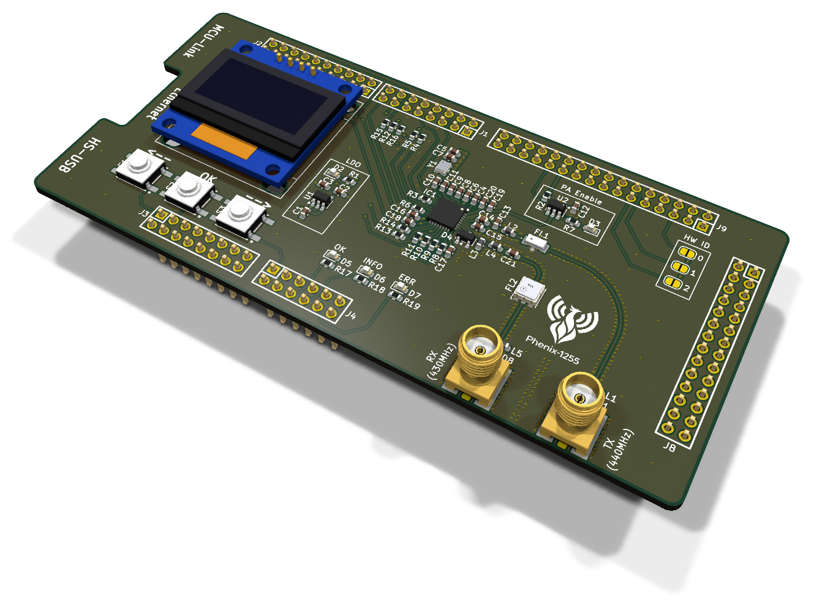
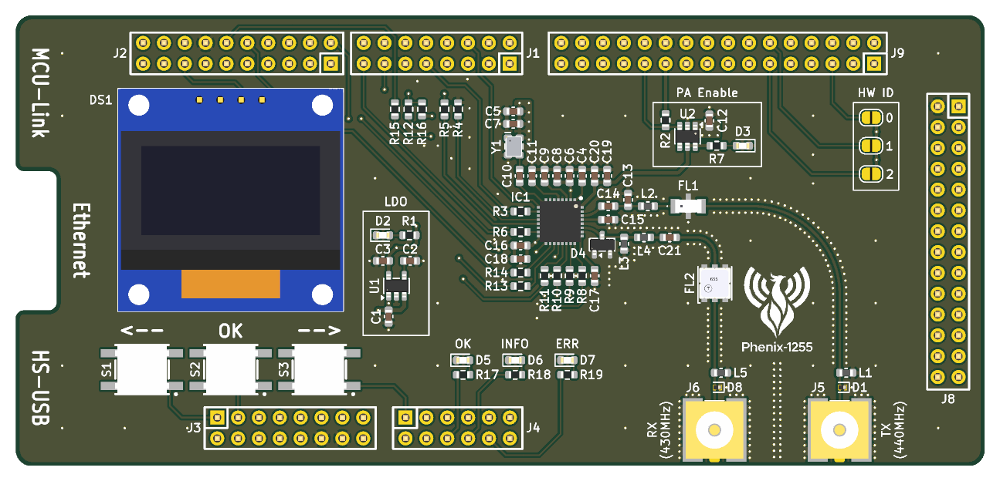
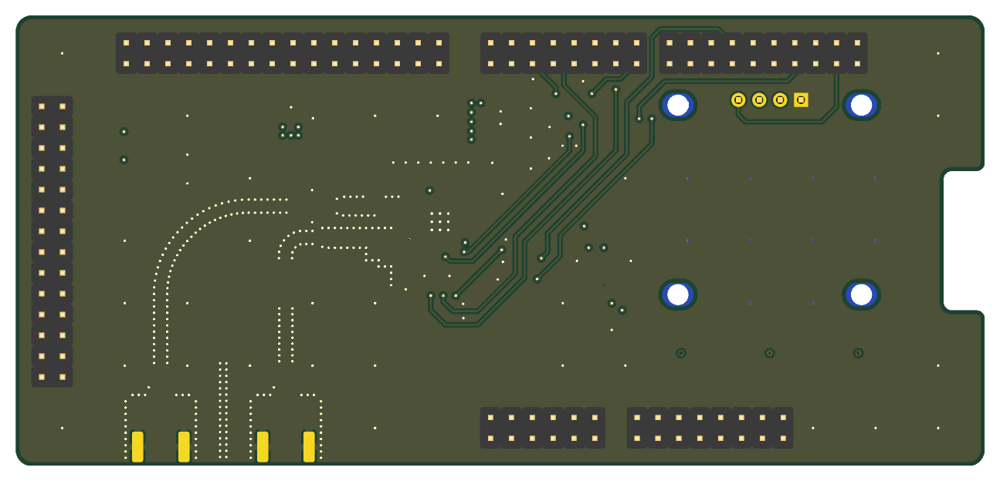
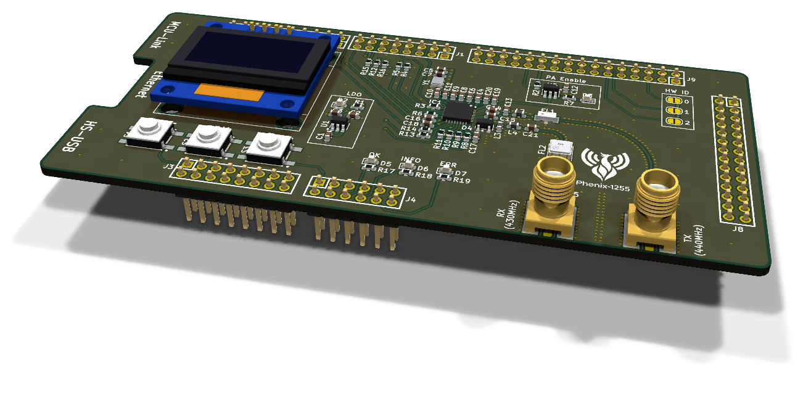
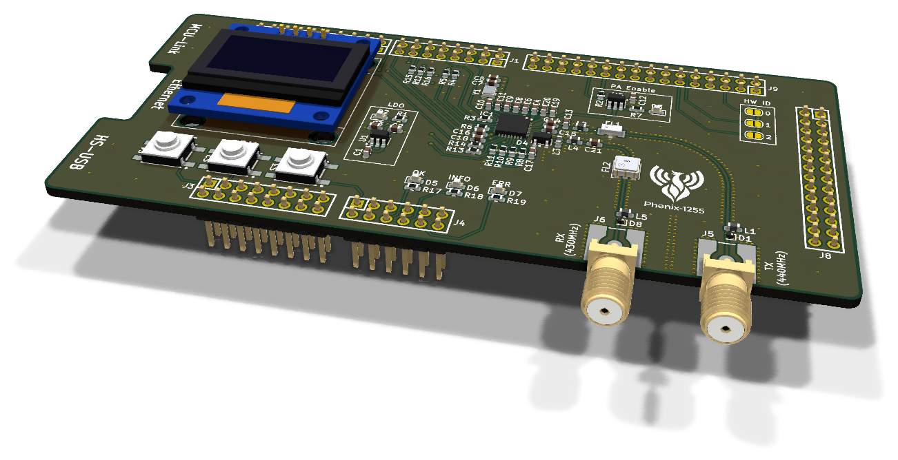

# phenix-1255-shield

Expansion board (shield) for the NXP **FRDM-MCXN947** development board, built around the Semtech **SX1255** RF transceiver (TX 440 MHz, RX 430 MHz).

Together with the firmware it turns the FRDM board into a multimode SDR transceiver for base stations: TETRA today, DMR, FM and more modes planned. The I/Q samples are streamed to a host over HS USB or Ethernet.

This board is the hardware part of [phenix-1255-sw](https://github.com/w4tchd0g/phenix-1255-sw). It is a modified version of [Phenix-1255-HW](https://github.com/labdvm/Phenix-1255-HW) by Z32IT ([@labdvm](https://github.com/labdvm)), see [Changes from Phenix-1255-HW](#changes-from-phenix-1255-hw).

> **Status:** design complete and ready for fabrication. The schematic passes ERC without errors, the PCB passes DRC without errors and without unrouted connections. The Gerber files for JLCPCB and PCBWay are in [`production/`](#fabrication). Before the first power-up, read the [bring-up checklist](#bring-up-checklist).

## Preview



| Top | Bottom |
|---|---|
|  |  |

### SMA connector options

J5 (TX) and J6 (RX) use a hybrid land pattern that takes either connector type. Populate only one connector per port.

| Vertical SMD jack (CONSMA001-SMD-G) | Edge mount (Samtec SMA-J-P-H-ST-EM1) |
|---|---|
|  |  |

- **CONSMA001-SMD-G:** reflowed with the other parts. The unused edge-mount centre pad forms a short open stub (about 1 pF). At 430/440 MHz it has practically no effect (return loss at the port ≥ 34 dB).
- **Edge mount:** the edge-mount pads have no paste, so solder the jack by hand after reflow. The GND pads connect to the fill through thermal reliefs to make this easier. Use a large chisel tip and preheat the board from below (about 120–150 °C).

## Changes from Phenix-1255-HW

The basic hardware concept comes from [labdvm/Phenix-1255-HW](https://github.com/labdvm/Phenix-1255-HW) (Copyright © Z32IT 2026, CERN-OHL-P-2.0). This project changes it as follows (2026-11):

- **Antenna matching:** new TX and RX matching networks between the SX1255 and the filters, see [RF matching networks](#rf-matching-networks).
- **RF connector layout:** hybrid land pattern for J5/J6 that takes either a vertical SMD jack or an edge-mount SMA jack, see [SMA connector options](#sma-connector-options).
- **PA supply switching:** an integrated load switch (TPS22917) replaces the P-channel MOSFET, see [Power](#power).

## Overview

| | |
|---|---|
| Base board | [NXP FRDM-MCXN947](https://www.nxp.com/design/design-center/development-boards-and-designs/FRDM-MCXN947) |
| EDA tool | KiCad 10 |
| Board size | 118 × 55 mm, R2 corners, 17 × 5 mm cutout (R1 corners) on the left edge for the Ethernet jack of the FRDM board |
| Stackup | 4 layers, 1.6 mm, JLCPCB JLC04161H-7628 |
| Assembly | all parts on the top side |
| Based on | [Phenix-1255-HW](https://github.com/labdvm/Phenix-1255-HW) by Z32IT (CERN-OHL-P-2.0), see [Changes from Phenix-1255-HW](#changes-from-phenix-1255-hw) |
| Shield template | FRDM-MCXN947 shield template from [wavenumber-eng/frdm-templates](https://github.com/wavenumber-eng/frdm-templates) (CC0): board outline, header placement and root schematic |

## Components

| Function | Part | Manufacturer |
|---|---|---|
| RF transceiver | SX1255IWLTRT (QFN-32, 5 × 5 mm) | Semtech |
| Reference clock | TG2520SMN 38.4 MHz TCXO (2.5 × 2.0 mm) | Epson |
| SAW filter 430 MHz (RX) | TA0655A | Tai-Saw |
| Low-pass filter (TX) | LFCN-490+ | Mini-Circuits |
| RF connectors (TX, RX) | CONSMA001-SMD-G (vertical, SMD) or SMA-J-P-H-ST-EM1 (edge mount), see [SMA connector options](#sma-connector-options) | TE / Linx, Samtec |
| ESD protection RF ports | PESD5V0F1BL | Nexperia |
| RX input limiter | BAV99 | Nexperia |
| LDO 3.3 V | LDK130M33R | ST |
| PA supply load switch | TPS22917LDBVR (active-low enable) | TI |
| Display | OLED 0.96″ 128×64, SSD1306, I²C, pin order GND/VDD/SCL/SDA (module with on-board pull-ups) | – |
| Tactile switch (SPST-NO, 6.5 × 6 mm, SMD), 3× | EVQ-Q2Y03W | Panasonic |
| Status LEDs 0603, 5× (PWR, PA, OK, INFO, ERR) | 150060xS75000 (green, yellow, red) | Würth |
| Hardware ID, 3× | solder jumper, open | – |
| Headers to the FRDM board | Samtec SSQ (from the template) | Samtec |

Passives are 0603 (resistors UNI-ROYAL `0603WAF…`, capacitors Samsung/Murata/Yageo, RF inductors Murata `LQW18AN…`). The manufacturer part numbers are stored in the `MPN` field of the symbols.

## Circuit

### Power

| Net | Source | Loads |
|---|---|---|
| `+5v0` | FRDM header J3.10 | LDO input |
| `+3.3V_LDO` | LDO on the shield (enable tied to `+5v0`) | SX1255 VBAT1/VBAT2, TCXO, load switch input, PWR LED |
| `VBAT3` | load switch, controlled by `~PA_EN` | SX1255 VBAT3 (PA supply), PA LED |
| `+3v3` | FRDM header (J3.4, J3.8, J9.21, J8.1) | display, buttons, HW-ID jumpers, `~PA_EN` pull-up |

The RF part runs from its own low-noise LDO. Only the MCU-side parts use the FRDM 3.3 V rail.

`~PA_EN` is **active low** and pulled up to `+3v3` with 100 kΩ, so the PA supply stays off until the firmware drives the pin low. The load switch uses quick output discharge (QOD tied to VOUT). CT is left open, which gives the fastest turn-on.

### RF

- **TX:** SX1255 RFO_P → matching network (100 pF / 3.6 pF / 18 nH) → LFCN-490+ low-pass → SMA **J5 (TX)**. RFO_N is AC-coupled to GND.
- **RX:** SMA **J6 (RX)** → TA0655A SAW filter → matching network (100 pF / 33 nH / 68 nH) → SX1255 RFI, with a BAV99 limiter at the RFI pin.
- **SMA ports:** each port has a 100 nH DC shunt to GND (L1/L5) and a low-capacitance TVS diode (D1/D8). Together with the stub of the SMD jack they need no further matching (return loss ≥ 24 dB).
- **RF lines:** 50 Ω coplanar waveguide with ground (CPWG) on F.Cu over the solid GND plane In1, 0.30 mm track, 0.30 mm gap (0.20 mm inside the SX1255 courtyard). A field-solver check gives about 52 Ω with solder mask, i.e. a return loss of about 33 dB. The lines are electrically short (longest RF net 23 mm ≈ 23° at 440 MHz).
- **Reference clock:** the 38.4 MHz TCXO drives XTB through 10 nF, XTA is left open (TCXO connection per the datasheet). 38.4 MHz is above the specified FXOSC range of the SX1255 (32 / 36 / 36.864 MHz min/typ/max, datasheet Rev. 3.0, table 5). It has been **tested and works**; keep in mind that it is outside the specification. All frequencies derived from FXOSC (PLL step, I/Q sample rate) scale with 38.4 MHz.

`scripts/rf_calc.py` reproduces all RF numbers in this README (CPWG impedance, SMA stub, port shunts, matching networks). It runs with the standard library; the field solver part also needs numpy and scipy (`pip install numpy scipy`).

### RF matching networks

The networks adapt the SX1255 impedances to the 50 Ω of the LFCN-490+ and the TA0655A. They are based on the SX1255 datasheet (Rev. 3.0) and on separate front-end design notes (*SX1255 RF front end: TX 440 MHz / RX 430 MHz*, not in this repository). The values are calculated with ideal components and are **start values**; the final tuning is done on the board with a VNA.

#### TX: 100 Ω → 50 Ω

```
RF_OP ──C14 100p──┬──L2 18n──► LFCN-490+ (50 Ω) ──► J5
                  │
               C13 3.6p
                  │
                 GND
RF_ON ──C15 100p── GND
```

The datasheet specifies an optimum load of **100 Ω differential** between RF_OP and RF_ON (section 3.4.4, peak output power +5 dBm). The output is used single-ended: C15 ties RF_ON to ground for RF, so RF_OP has to see 100 Ω. The low-pass L-network (Q = 1) transforms 50 Ω up to 100 Ω:

| Element | Calculated | Used |
|---|---|---|
| Shunt C | 3.62 pF | **C13 = 3.6 pF** (C0G, ±0.1 pF) |
| Series L | 18.09 nH | **L2 = 18 nH** (wirewound, ±2 %) |

C14 (100 pF) only blocks DC. With the values used, RF_OP sees 99.5 − j3.1 Ω at 440 MHz (return loss 35.9 dB, ≥ 22 dB from 400 to 480 MHz, ≥ 29.9 dB within the component tolerances). The network adds 3.3 dB attenuation at the 2nd and 9.5 dB at the 3rd harmonic on top of the LFCN-490+.

**Tuning element: C13.** The output capacitance of RF_OP is not specified and appears in parallel with C13. Trim C13 for maximum output power at J5.

#### RX: 50 Ω → 200 Ω

```
J6 ──► TA0655A (50 Ω) ──C21 100p──L4 33n──┬────────┬────────┬──► RF_IN (200 Ω)
                                          │        │        │
                                        L3 68n   D4 BAV99  C_pin (LNA input)
                                          │        │        │
                                         GND      GND      GND
```

RF_IN is a common-gate LNA with an input impedance of 50 Ω or 200 Ω, selected with the bit LnaZin in RegRxAnaGain (section 3.6.2). The network is designed for **200 Ω** (see [Firmware notes](#firmware-notes)).

The ideal L-network at 430 MHz is a series L of 32.05 nH (**L4 = 33 nH**) and a shunt C of 3.21 pF at RF_IN. There is no shunt capacitor on the board: that capacitance comes from the RF_IN node itself (LNA input, BAV99, pad, track). The design assumes it is larger than needed, and **L3 (68 nH)** compensates the excess (68 nH cancels 2.01 pF at 430 MHz). L3 also gives RF_IN a DC path to ground. The values used require a **total capacitance of 5.24 pF at RF_IN**. The datasheet does not specify it, so this is the critical assumption of the RX match:

| Total capacitance at RF_IN | Return loss at 430 MHz | Best match at |
|---|---|---|
| 4.0 pF | 10.0 dB | 495 MHz |
| 4.5 pF | 14.2 dB | 466 MHz |
| 5.0 pF | 23.7 dB | 441 MHz |
| **5.24 pF** | **40.0 dB** | **431 MHz** |
| 5.5 pF | 23.1 dB | 420 MHz |
| 6.0 pF | 14.0 dB | 401 MHz |

With the nominal value the return loss is ≥ 20 dB from 414 to 447 MHz, much wider than the 4 MHz passband of the TA0655A.

**Tuning element: L3.** For a match at 430 MHz: 4 pF → 177 nH, 5 pF → 77 nH, 6 pF → 49 nH, 7 pF → 36 nH. Procedure (from the design notes): before the TA0655A is fitted, solder a coax pigtail to its output pad (pin E) and measure S11 towards the SX1255. If the minimum is above 430 MHz, increase L3; if it is below, decrease L3. Adjust the depth with L4 (27 / 33 / 39 nH). Target S11 ≤ −10 dB, then optimise for best sensitivity.

### Digital interface

All signals between the SX1255 and the headers have 33 Ω series resistors at the driving end: next to the SX1255 for its outputs (`CK_OUT`, `I_OUT`, `MISO`, `DIO0..3`), next to the headers for the MCU outputs (`SCK`, `MOSI`, `NSS`, `I_IN`). NSS has a 10 kΩ pull-up to `+3.3V_LDO`. CK_IN and Q_IN are unused inputs: pins 11 and 12 are bridged next to the SX1255 and pulled down together with one 10 kΩ resistor (R4). Q_OUT and XTA are not connected.

## MCU pin assignment

| Net | Header | FRDM signal | Function |
|---|---|---|---|
| `SCK` | J2.12 | P0_25 / FC1_SCK | SX1255 SPI |
| `MISO` | J2.10 | P0_26 / FC1_SDI | SX1255 SPI |
| `MOSI` | J2.8 | P0_24 / FC1_SDO | SX1255 SPI |
| `NSS` | J1.16 | P0_31 | SX1255 SPI chip select (GPIO) |
| `SX_RST` | J1.6 | P0_29 | SX1255 reset (active high) |
| `DIO0` | J2.2 | P0_28 | SX1255 DIO0 |
| `DIO1` | J1.10 | P0_30 / P4_13 | SX1255 DIO1 |
| `DIO2/WS` | J1.13 | P3_19 / SAI1_RX_FS | SX1255 DIO2, I/Q word select |
| `DIO3` | J2.13 | P0_19 | SX1255 DIO3 |
| `CK_OUT` | J1.9 | P3_18 / SAI1_RX_BCLK | I/Q bit clock from SX1255 |
| `I_OUT` | J1.15 | P3_21 / SAI1_RXD0 | I/Q data SX1255 → MCU |
| `I_IN` | J1.5 | P3_20 / SAI1_TXD0 | I/Q data MCU → SX1255 |
| `~PA_EN` | J9.23 | P1_23 / EZH_LCD_RD | PA supply enable, active low |
| `SDA` | J2.17 | P1_0 | Display I²C |
| `SCL` | J2.15 | P1_1 | Display I²C |
| `BTN_0` | J3.1 | P2_0 | Button S1 (`<--`) |
| `BTN_1` | J3.3 | P1_22 | Button S2 (`OK`) |
| `BTN_2` | J4.1 | P4_12 / P0_21 | Button S3 (`-->`) |
| `LED_0` | J4.6 | P0_14 | LED OK (green) |
| `LED_1` | J4.8 | P0_22 | LED INFO (yellow) |
| `LED_2` | J4.10 | P0_15 (solder jumper SJ8 1-2, FRDM default) | LED ERR (red) |
| `HW_ID_0` | J9.5 | P1_19 / EZH_LCD_D15_CAMERA_RST | Hardware ID bit 0 |
| `HW_ID_1` | J9.12 | P3_4 | Hardware ID bit 1 |
| `HW_ID_2` | J9.11 | P3_5 | Hardware ID bit 2 |

Where the template lists two MCU pins (e.g. `P0_15 / P2_0`), the FRDM board routes the header pin to one of them via a solder jumper or resistor option. The pins above are the defaults from the FRDM-MCXN947 user manual (UM12018 Rev. 2.0). Some MCU pins also reach a second header on the FRDM board; on this shield the second pin is always left unconnected:

- P2_0 (`BTN_0`, J3.1) also goes to J9.25 (R167). It only reaches J4.10 if SJ8 is changed to 2-3, which would short `BTN_0` and `LED_2`. **Leave SJ8 on the FRDM board in its default position 1-2.**
- P1_22 (`BTN_1`, J3.3) also goes to J9.24.
- P1_23 (`~PA_EN`, J9.23) also goes to J1.8 (SJ1 1-2, default).

### Firmware notes

- **Buttons and HW-ID jumpers** switch to `+3v3` and have no external pull-downs. Enable the **internal pull-downs** on `BTN_x` and `HW_ID_x`. A pressed button or a closed jumper reads as `1`.
- **LEDs** `LED_0..2` are active high (1 kΩ to the LED). The PWR LED is always on, the PA LED lights while `VBAT3` is powered.
- **`SX_RST`** must stay **floating** in normal operation, as required by the SX1255 datasheet. Configure the GPIO as an input without pull resistor and drive it high only to reset.
- **`~PA_EN`**: drive it low to power the PA, drive it high or release it to switch the PA off.
- **LNA input impedance**: keep LnaZin (RegRxAnaGain, register 0x0C bit 0, reset value 1) at 1 = 200 Ω. The RX matching is designed for it; 50 Ω detunes the RX input.
- **I/Q interface**: SAI1 receives with the bit clock and frame sync from the SX1255; the transmitter has to run synchronously to the receiver.
- **Reference clock**: FXOSC is 38.4 MHz, not the 36 MHz of the datasheet examples. Calculate PLL and sample-rate settings with 38.4 MHz.

## PCB

### Stackup

JLCPCB JLC04161H-7628, 1.6 mm, 4 layers:

| Layer | Use | Dielectric to next layer |
|---|---|---|
| F.Cu | signals and RF (CPWG), GND fill | 0.21 mm prepreg 7628, εr 4.4 |
| In1.Cu | solid GND plane, no routing | 1.065 mm core, εr 4.6 |
| In2.Cu | power plane (`+3v3`, `+3.3V_LDO` and `+5v0` areas), GND below the RF section | 0.21 mm prepreg 7628, εr 4.4 |
| B.Cu | signals (SPI, DIO, SDA), GND fill | – |

The RF section has no vias in the signal path and no tracks on the inner layers or B.Cu. The GND layers are tied together with via fences along the RF lines and a stitching grid; the SX1255 exposed pad has thermal vias. Design minimums: 0.15 mm track and clearance, 0.3 mm drill, 0.5 mm via diameter (vias used: 0.6 / 0.3 mm and 0.8 / 0.4 mm).

## Fabrication

Production files are in `production/`:

- `production/phenix-1255-shield-gerber.zip` – upload this to JLCPCB or PCBWay (Gerber X1, Protel extensions, Excellon drill, PTH and NPTH separate).
- `production/gerber/` – the same files unpacked, plus the drill maps.

Order settings:

- **JLCPCB:** 4 layers, 1.6 mm, stackup **JLC04161H-7628** (the RF lines are calculated for it), 1 oz outer copper.
- **PCBWay:** 4 layers, 1.6 mm, 1 oz outer copper. The standard stackup is not guaranteed to match, so specify the [stackup](#stackup) in the order remark: layer order F.Cu (`.gtl`), In1.Cu (`.g1`), In2.Cu (`.g2`), B.Cu (`.gbl`); 0.21 mm prepreg 7628 between F.Cu and In1.Cu. The 50 Ω CPWG on F.Cu (0.30 mm track, 0.30 mm gap to the coplanar GND, reference In1.Cu) depends on that prepreg thickness.

Regenerate the files after every layout change:

```sh
./scripts/gerber.sh   # aborts if the DRC reports errors or unconnected items
./scripts/render.sh   # updates the images in docs/img/
```

### Assembly notes

- All SMD parts are on the top side. Populate **one** SMA connector type per port (see [SMA connector options](#sma-connector-options)).
- The FRDM headers J1–J4, J8 and J9 are marked *Do not populate* on the PCB, so they are not in a BOM or position file exported from the PCB. Solder them by hand.
- The hardware ID jumpers JP1–JP3 are open; close them with solder as needed.
- If the RX match is to be measured (see [RF matching networks](#rf-matching-networks)), leave the TA0655A off the first board.

## Bring-up checklist

These points cannot be checked on paper and need a measurement on the first board:

- **TX output:** check the single-ended output on RFO_P (no DC feed) against the Semtech reference design, and trim C13 for maximum output power.
- **RX match:** the match assumes 5.24 pF at RF_IN, which the datasheet does not specify. Measure S11 at the TA0655A output and adjust L3/L4.
- **PA supply:** confirm that the SX1255 tolerates VBAT3 switched off while VBAT1/VBAT2 are powered.
- **Reference clock:** 38.4 MHz is outside the SX1255 specification (tested and working, see [RF](#rf)).

## Project structure

```
phenix-1255-shield/
├── phenix-1255-shield.kicad_pro    # project file – open this one
├── phenix-1255-shield.kicad_sch    # root schematic: FRDM headers, PWR_FLAGs
├── schematic.kicad_sch             # sub-sheet: SX1255, RF, power, UI
├── phenix-1255-shield.kicad_pcb    # PCB
├── phenix-1255-shield.kicad_dru    # custom design rules (RF, stitching)
├── phenix-1255-shield.kicad_sym    # symbols from the template
├── sym-lib-table / fp-lib-table    # project libraries
├── empty.kicad_wks                 # drawing sheet
├── scripts/gerber.sh               # Gerber and drill files for JLCPCB and PCBWay
├── scripts/render.sh               # renders the images in docs/img/
├── scripts/sma_variant.py          # helper for render.sh: SMD / edge-mount SMA view
├── scripts/trim.py                 # helper for render.sh: crops the images to the board
├── scripts/rf_calc.py              # CPWG impedance, SMA stub and matching network calculation
├── scripts/make_3d_models.py       # generates the simplified 3D models in ext_parts/3d/
├── docs/img/                       # rendered PCB images
├── production/                     # Gerber and drill files (generated)
├── ext_parts/                      # project-specific symbols, footprints and 3D models
└── LICENSE                         # CERN-OHL-P-2.0
```

## Usage

1. Clone the repository.
2. Open `phenix-1255-shield.kicad_pro` in KiCad 10.

The project-specific libraries are linked relative to the project via `${KIPRJMOD}`. Standard parts and their 3D models come from the KiCad 10 libraries that are installed with KiCad. Nothing else needs to be installed or configured.

**Notes:**

- According to NXP, the connectors in the template are 2–6 mil off from the exact Arduino positions. This is a design bug of the FRDM-MCXN947 itself; the shield still mates with the board.
- Always double-check the header IO assignments against the current FRDM-MCXN947 documentation before ordering boards.

## License

Copyright © Z32IT 2026 (original design [Phenix-1255-HW](https://github.com/labdvm/Phenix-1255-HW)).
Modifications copyright © w4tchd0g 2026.

This project (schematics, PCB, the libraries in `ext_parts/`, scripts and documentation) is a modified version of [Phenix-1255-HW](https://github.com/labdvm/Phenix-1255-HW) (see [Changes from Phenix-1255-HW](#changes-from-phenix-1255-hw)) and is licensed under the [CERN Open Hardware Licence Version 2 – Permissive](LICENSE) (CERN-OHL-P-2.0), except for the third-party content listed below.

Third-party content:

- **Shield template** ([wavenumber-eng/frdm-templates](https://github.com/wavenumber-eng/frdm-templates), FRDM-MCXN947 KiCad template): board outline, header footprints and their placement, root schematic with the header symbols (`phenix-1255-shield.kicad_sch`, `phenix-1255-shield.kicad_sym`). [CC0 1.0](https://creativecommons.org/publicdomain/zero/1.0/)
- **Display footprint** `Display_128x64_096_I2C`: by TG9541 ([kicad-footprints](https://github.com/TG9541/kicad-footprints)), [CC0 1.0](https://creativecommons.org/publicdomain/zero/1.0/)
- **SMA edge-mount option:** the edge-mount pads in `CONSMA001-SMD-G_EdgeHybrid` and the 3D model `SMA_Samtec_SMA-J-P-H-ST-EM1_EdgeMount.step` are derived from the [KiCad libraries](https://www.kicad.org/libraries/license/) (footprint and 3D model `SMA_Samtec_SMA-J-P-H-ST-EM1_EdgeMount`), [CC-BY-SA 4.0](https://creativecommons.org/licenses/by-sa/4.0/). The changes (merged land pattern, added insulator and centre socket) are under the same license.
- **Standard parts:** footprints and 3D models from the KiCad libraries are referenced, not included (CC-BY-SA 4.0 with the KiCad library exception for designs).

Datasheets are not part of this repository; the `Datasheet` field of each part links to the manufacturer.

This source is distributed **WITHOUT ANY EXPRESS OR IMPLIED WARRANTY, INCLUDING OF MERCHANTABILITY, SATISFACTORY QUALITY AND FITNESS FOR A PARTICULAR PURPOSE**. Please see the CERN-OHL-P-2.0 for applicable conditions.

Source location: <https://github.com/w4tchd0g/phenix-1255-shield>
